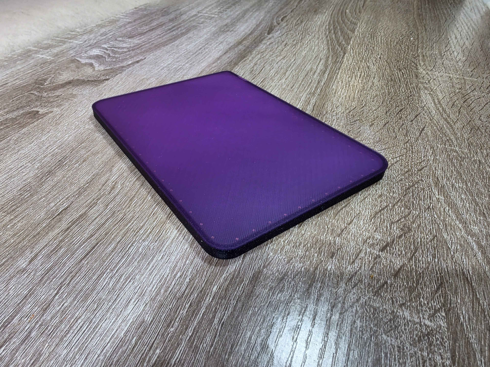
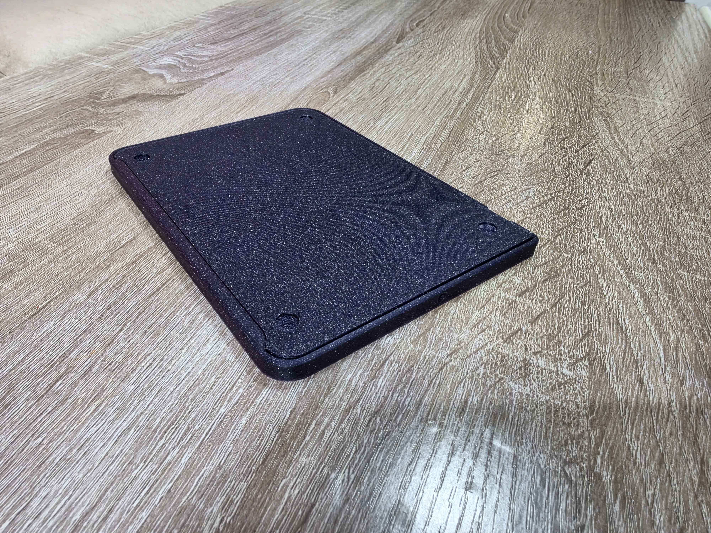
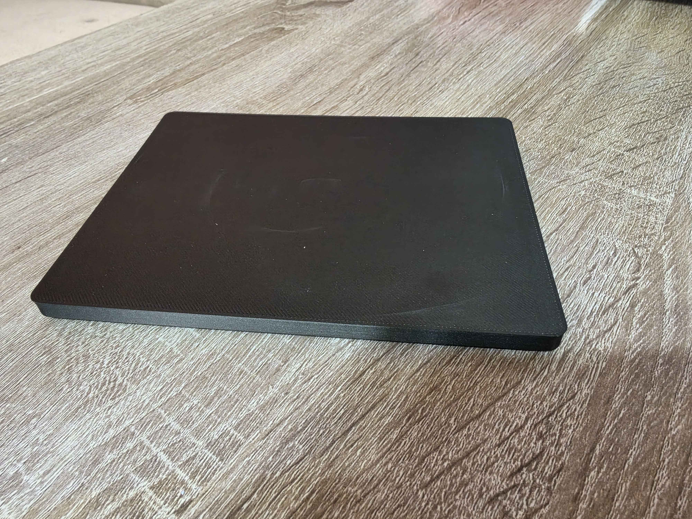
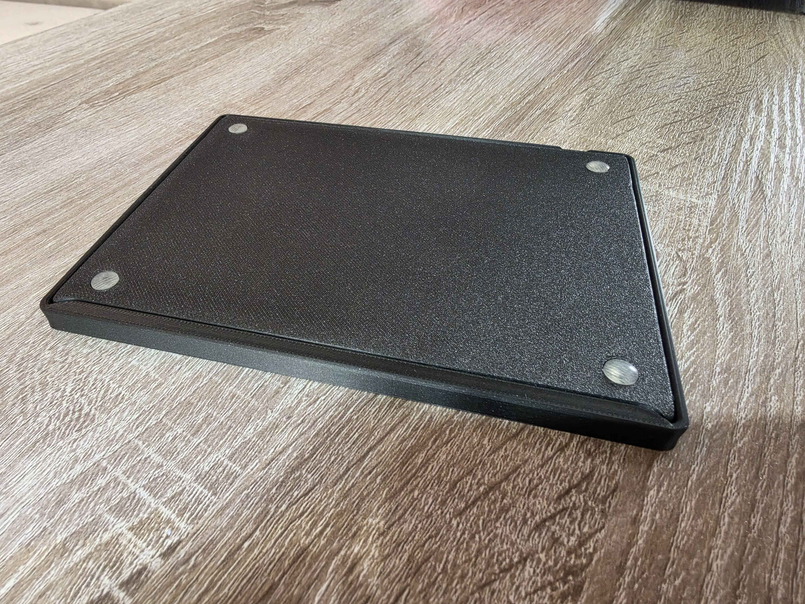

| Model | Top | Bottom |
| --- | --- | --- |
| Legacy Design |  | 
| Uniform Corners (Recommended) |  |  |

# Flat (Ploopy) Trackpad
A thin case for The [Ploopy Trackpad](https://github.com/ploopyco/trackpad) with zero degree incline.

# Requirements
- 3x screws (included in your Ploopy Trackpad kit)
- 4x 8mm rubber feet

# Assembly
The same way you assemble your trackpad kit.

# Additional Info
## Glass Top
If you are interested in getting yourself a custom-cut glass screen protector for the touch surface, here are the dimensions to cover the entire area.

### Legacy
- Width: 177.0mm
- Height: 132.00mm

Corner Radius:
- Top Left: 5.0mm
- Top Right: 15.0mm
- Bottom Left: 12.0mm
- Bottom Right: 12.0mm

### Uniform Corners
- Width: 177mm
- Height: 132mm

Corner Radius:
- All: 5mm